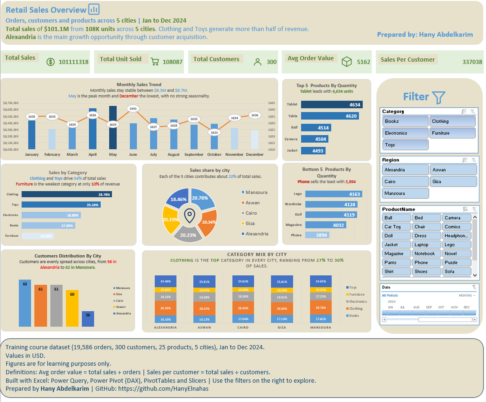
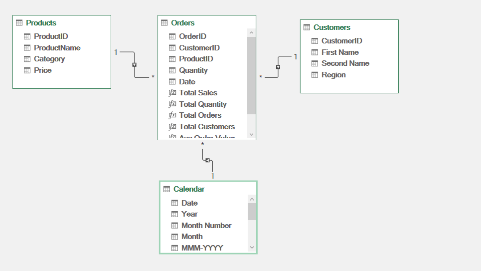
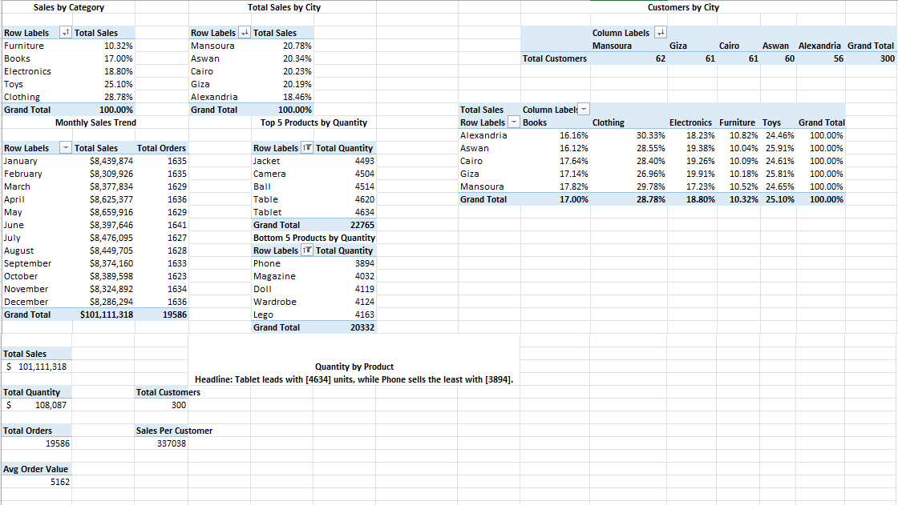

# Retail Sales Dashboard | Excel, Power Query, Power Pivot

An end-to-end sales analytics project built entirely in **Microsoft Excel**: raw CSV files are cleaned and combined with **Power Query**, modeled as a star schema in **Power Pivot** with **DAX** measures, summarized in **PivotTables**, and presented in an interactive, slicer-driven **dashboard**.



> **Data note:** the dataset comes from a training course. Figures are for learning purposes only, and some patterns (for example, very stable monthly sales) are more uniform than real-world data.

---

## Table of Contents

1. [Project Overview](#project-overview)
2. [Business Questions](#business-questions)
3. [Tools and Skills](#tools-and-skills)
4. [Repository Structure](#repository-structure)
5. [Data Sources](#data-sources)
6. [Step 1: Data Cleaning in Power Query](#step-1-data-cleaning-in-power-query)
7. [Step 2: Data Modeling in Power Pivot](#step-2-data-modeling-in-power-pivot)
8. [Step 3: PivotTables](#step-3-pivottables)
9. [Step 4: The Dashboard](#step-4-the-dashboard)
10. [Key Insights](#key-insights)
11. [Recommendations for the Client](#recommendations-for-the-client)
12. [Limitations and Next Steps](#limitations-and-next-steps)
13. [How to Use This Project](#how-to-use-this-project)
14. [Author](#author)

---

## Project Overview

The client wants a single page that answers: *How are we selling, where, and what should we do next?*

The workflow follows a standard analytics pipeline:

```
Raw CSV files  →  Power Query (clean + combine)  →  Power Pivot (star schema + DAX)
              →  PivotTables  →  Interactive dashboard  →  Insights and recommendations
```

**Headline numbers:** $101.1M total sales, 108,087 units sold, 19,586 orders, 300 customers, 25 products, 5 cities, January to December 2024.

---

## Business Questions

- How much did we sell, and how many orders, units and customers does that represent?
- Which months are strongest, and is there seasonality?
- Which product categories drive revenue?
- Which cities perform best, and why is one city behind?
- Which products sell the most and the least?
- Does the category mix differ by city?

---

## Tools and Skills

| Area | Tools / techniques |
|---|---|
| Data preparation | Power Query (M language), folder-based file combination, text and date cleaning |
| Data modeling | Power Pivot, star schema, relationships, Calendar table |
| Calculations | DAX measures (Total Sales, Average Order Value, Sales per Customer) |
| Analysis | PivotTables, Top N filters, % of total and % of row total |
| Visualization | PivotCharts, slicers, timeline, KPI cards, dashboard layout and data storytelling |

---

## Repository Structure

```
retail-sales-dashboard-excel/
│
├── Retail_Sales_Dashboard.xlsx     # Full workbook: model, pivot tables and dashboard
├── power-query/
│   ├── customers.m                 # Customers query (M code)
│   ├── products.m                  # Products query (M code)
│   └── orders.m                    # Orders query (M code)
├── dax/
│   └── measures.dax                # DAX measures used in the data model
├── images/
│   ├── dashboard.png               # Final dashboard
│   ├── pivot_tables.png            # PivotTables behind the charts
│   └── data_model.png              # Power Pivot diagram view
└── README.md
```

---

## Data Sources

| Table | Format | Grain | Main columns |
|---|---|---|---|
| **Customers** | Single CSV | One row per customer | CustomerID, CustomerName, Region |
| **Products** | Single CSV | One row per product | ProductID, ProductName, Category, Price |
| **Orders** | Folder of monthly CSV files | One row per order line | OrderID, CustomerID, ProductID, OrderDate, Quantity |

The Orders data is split across several files (one per month), and the month is part of each file name.
The Data was for training provided from a Smart Investment Solutions Company:https://www.linkedin.com/company/sis-platform/
Under Supervision the Data Analysis Instructor :https://www.linkedin.com/in/mohamed-mahmoud-sobhy-668ba937a/
---

## Step 1: Data Cleaning in Power Query

The full M code for each query is in the [`power-query/`](power-query) folder. Below is what each query does and why.

### Customers

| Step | What it does | Why |
|---|---|---|
| Promote headers, set types | `CustomerID` as whole number, text columns as text | Correct data types from the start |
| Capitalize each word + Trim | Applied to names and Region | Removes inconsistent casing and stray spaces that would split one city into several |
| Replace `" "` with `""` in Region | Removes internal spaces | Gives clean, consistent region values |
| Split `CustomerName` by space | Creates `First Name` and `Second Name` | Easier to sort, search and display |
| Rename columns | Friendly column names | Readable field list in Power Pivot |

### Products

| Step | What it does | Why |
|---|---|---|
| Promote headers, set types | Initially `Price` loaded as text | Allows inspection before converting |
| Capitalize + Trim | Applied to `ProductName` and `Category` | Consistent labels for slicers and charts |
| Replace `"Two Hundred"` with `"200"` | Fixes a price written as words | This value would otherwise make the numeric conversion fail |
| Change `Price` to Currency | Final numeric type | Required for the Total Sales calculation |

### Orders

This is the most complex query because the files and dates need extra work.

| Step | What it does | Why |
|---|---|---|
| Load from folder + filter hidden files | `Folder.Files` with a hidden-file filter | Combines all monthly files automatically, so new files are picked up on refresh |
| Invoke custom function and expand | Applies one transformation to every file | Standard "combine files" pattern |
| Set types | `CustomerID`, `ProductID`, `OrderID`, `Quantity` as whole numbers | Correct types for modeling |
| Remove rows with empty `ProductID`, `OrderDate` or `Quantity` | Three row filters | Drops incomplete order lines that cannot be analyzed |
| Replace original `OrderID` with an index | Remove the column, add an index, rename to `OrderID` | Creates a unique sequential key for every order line |
| Standardize date text | Replace `/` with `-`, split `OrderDate` into three parts | Dates arrive in mixed layouts, so each part is handled separately |
| Identify the **Year** | The part greater than 31 is the year | A value above 31 cannot be a day or a month |
| Extract the **Month** from the file name | `Text.BetweenDelimiters([Source.Name], "_", ".")` | The month is reliably stored in the file name |
| Identify the **Day** | The remaining part that is 31 or less and different from the month | Resolves which of the two parts is the day |
| Combine into `Date` | Month-Day-Year text, converted to `type date` | Produces one clean date column for the Calendar relationship |

**Date handling in practice:** converting ambiguous text such as `23-01-2024` directly to a date depends on the machine's regional settings and can fail or silently swap day and month. Rebuilding the date from separately identified Year, Month and Day avoids that. Always spot-check dates where day and month are both 12 or lower.

**Result:** three clean tables loaded to the Data Model (Customers 300 rows, Products 25 rows, Orders 19,586 rows).

---

## Step 2: Data Modeling in Power Pivot

The cleaned tables are loaded to the **Data Model** and connected as a **star schema**: one fact table (Orders) surrounded by three dimension tables.



| Relationship | Cardinality | Direction |
|---|---|---|
| Products (ProductID) → Orders | One-to-many | Single |
| Customers (CustomerID) → Orders | One-to-many | Single |
| Calendar (Date) → Orders | One-to-many | Single |

**Calendar table:** a dedicated date table with Date, Year, Month Number, Month and MMM-YYYY. It enables correct month ordering and is the source for the Date timeline slicer.

**Why a star schema:** filters flow from the small dimension tables to the large fact table, so every slicer (category, region, product, date) affects every measure consistently.

### DAX Measures

Defined in the Orders table (also in [`dax/measures.dax`](dax/measures.dax)):

```dax
Total Sales        = SUMX ( Orders, Orders[Quantity] * RELATED ( Products[Price] ) )
Total Quantity     = SUM ( Orders[Quantity] )
Total Orders       = DISTINCTCOUNT ( Orders[OrderID] )
Total Customers    = DISTINCTCOUNT ( Orders[CustomerID] )
Avg Order Value    = DIVIDE ( [Total Sales], [Total Orders] )
Sales Per Customer = DIVIDE ( [Total Sales], [Total Customers] )
```

Measures are used instead of plain sums so every number (including the KPI cards) reacts correctly to the slicers.

---

## Step 3: PivotTables

All PivotTables read from the Data Model and sit on a separate sheet that feeds the dashboard.



| PivotTable | Rows / Columns | Values | Used for |
|---|---|---|---|
| Sales by Category | Category | Total Sales (% of grand total), sorted | Category bar chart |
| Total Sales by City | Region | Total Sales (% of grand total), sorted | City donut chart |
| Customers by City | Region | Total Customers | Customers distribution chart |
| Monthly Sales Trend | Month | Total Sales, Total Orders | Combo chart (columns + line) |
| Top 5 Products by Quantity | ProductName (Top 5 filter) | Total Quantity | Top 5 bar chart |
| Bottom 5 Products by Quantity | ProductName (Bottom 5 filter) | Total Quantity | Bottom 5 bar chart |
| Category Mix by City | Region × Category | Total Sales (% of row total) | 100% stacked column chart |
| KPI cells | None | Total Sales, Total Quantity, Total Orders, Total Customers, Avg Order Value, Sales Per Customer | KPI cards |

---

## Step 4: The Dashboard

The dashboard is a single Excel sheet built from the PivotTables above, with the grid lines hidden and every visual connected to the same slicers.


### Layout

| Zone | Content |
|---|---|
| Header | Title, scope (5 cities, Jan to Dec 2024), executive summary, author |
| KPI row | Total Sales, Units Sold, Customers, Avg Order Value, Sales Per Customer (linked to cells that read the PivotTables) |
| Main area | Monthly Sales Trend, Top 5 and Bottom 5 Products, Sales by Category, Sales Share by City, Customers by City, Category Mix by City |
| Filter panel | Slicers for Category, Region and ProductName, plus a Date timeline |
| Footer | Data source, definitions, tools used |

### Design choices

- Each chart has a one-line analytical headline (a number plus its meaning) instead of a generic title.
- Reading order runs top to bottom: KPIs first, trend next, comparisons after, details last.
- One highlight color per chart marks the item that matters (for example, the peak month or the leading product).
- All slicers are connected to every PivotTable through Report Connections, so KPI cards and charts update together.

### KPI definitions

- **Average order value** = total sales ÷ total orders
- **Sales per customer** = total sales ÷ total customers

---

## Key Insights

**1. Revenue is concentrated in two categories.**
Clothing (28.8%) and Toys (25.1%) together generate **about 54%** of sales. Furniture is the weakest category at **10.3%**.

**2. Sales are evenly spread across cities, with one clear laggard.**
Each city contributes roughly 20% of sales. Alexandria is the only one below that level at **18.5% ($18.7M)**, versus 20.2% to 20.8% elsewhere.

**3. Alexandria's gap comes from customer count, not from spending or product mix.**
Alexandria has **56 customers** compared with 60 to 62 in the other cities. Its sales per customer (about $333K) is in line with the others ($335K to $343K), and its Clothing share (30.3%) is actually the highest of all cities.

| City | Sales | Customers | Sales per customer |
|---|---|---|---|
| Mansoura | $21.0M | 62 | $339K |
| Aswan | $20.6M | 60 | $343K |
| Cairo | $20.5M | 61 | $335K |
| Giza | $20.4M | 61 | $335K |
| Alexandria | $18.7M | 56 | $333K |

**4. Monthly sales are stable, with a gentle decline in the second half.**
Sales stay between **$8.29M and $8.66M** (a spread of about 4.5%). May is the peak ($8.66M) and December is the lowest ($8.29M). Order counts are almost flat (1,623 to 1,641 per month), so the monthly differences come from **order value**, not from order volume: May's average order value is roughly 5% higher than December's.

**5. Product demand is evenly distributed.**
The top 5 products (Tablet, Table, Ball, Camera, Jacket) account for **21.1%** of units and the bottom 5 (Phone, Magazine, Doll, Wardrobe, Lego) for **18.8%**. The gap between the best seller (Tablet, 4,634 units) and the weakest (Phone, 3,894 units) is about 16%, so no product is a clear failure.

**6. Category mix is consistent across cities.**
Clothing is the top category in every city (27% to 30% of sales), followed by Toys (24% to 26%). Differences between cities are small.

---

## Recommendations for the Client

| # | Recommendation | Evidence | Expected impact |
|---|---|---|---|
| 1 | **Run a customer-acquisition campaign in Alexandria** | 56 customers versus 60 to 62 elsewhere, with spend per customer already on par | Reaching 61 customers (+5) at current spend would add roughly **$1.7M** in sales (potential, not a forecast) |
| 2 | **Prioritize Clothing and Toys** in marketing budget and stock planning | 54% of revenue from two categories | Protects the core of the business |
| 3 | **Review Furniture** (pricing, assortment, promotion) before changing the range | Only 10.3% of sales | Checks whether the weakness is price-related or demand-related |
| 4 | **Lift average order value in the second half** with bundles and upsell offers | Order volume is flat while order value falls from May to December | Recovers part of the roughly 4% decline from the May peak |
| 5 | **Keep stock levels balanced** and ensure the top 5 products are never out of stock | Demand is spread evenly across 25 products | Avoids lost sales on the best sellers without overstocking |
| 6 | **Test promotions on the bottom 5 products** (Phone, Magazine) before removing any | 16% gap between best and worst, and units do not equal revenue | Identifies whether low volume is a pricing or visibility issue |

---

## Limitations and Next Steps

**Limitations**
- Training dataset: results illustrate the method and should not be read as findings about a real company.
- Products are ranked by **units sold**. Revenue and margin rankings could differ, and no cost data is available, so profitability cannot be assessed.
- Date reconstruction in Power Query relies on the file name for the month. Dates where both remaining parts are 31 or less and neither matches the month are handled by order of checks, so unusual files should be reviewed.
- Source paths in the M scripts are local and must be updated before refreshing on another machine.

**Next steps**
- Replace hard-coded file paths with a Power Query parameter for the data folder.
- Add year-over-year and month-over-month measures (requires more than one year of data).
- Add a profit margin analysis if cost data becomes available.
- Rebuild the same report in Power BI.

---

## How to Use This Project

1. Download `Retail_Sales_Dashboard.xlsx` and open it in Microsoft Excel (desktop, Microsoft 365 or Excel 2016 and later with Power Pivot enabled).
2. Go to the dashboard sheet and use the slicers on the right to filter by category, region, product and date.
3. To inspect the logic: **Data → Queries & Connections** for Power Query, **Power Pivot → Manage** for the model and measures, and the pivot sheet for the summary tables.
4. To rebuild from raw files: update the source paths in the queries (see [`power-query/`](power-query)), then **Data → Refresh All**.

---

## Author

**Hany Abdelkarim**

- GitHub: [HanyElnahas](https://github.com/HanyElnahas)
- LinkedIn: www.linkedin.com/in/hany-hassan-53787267
